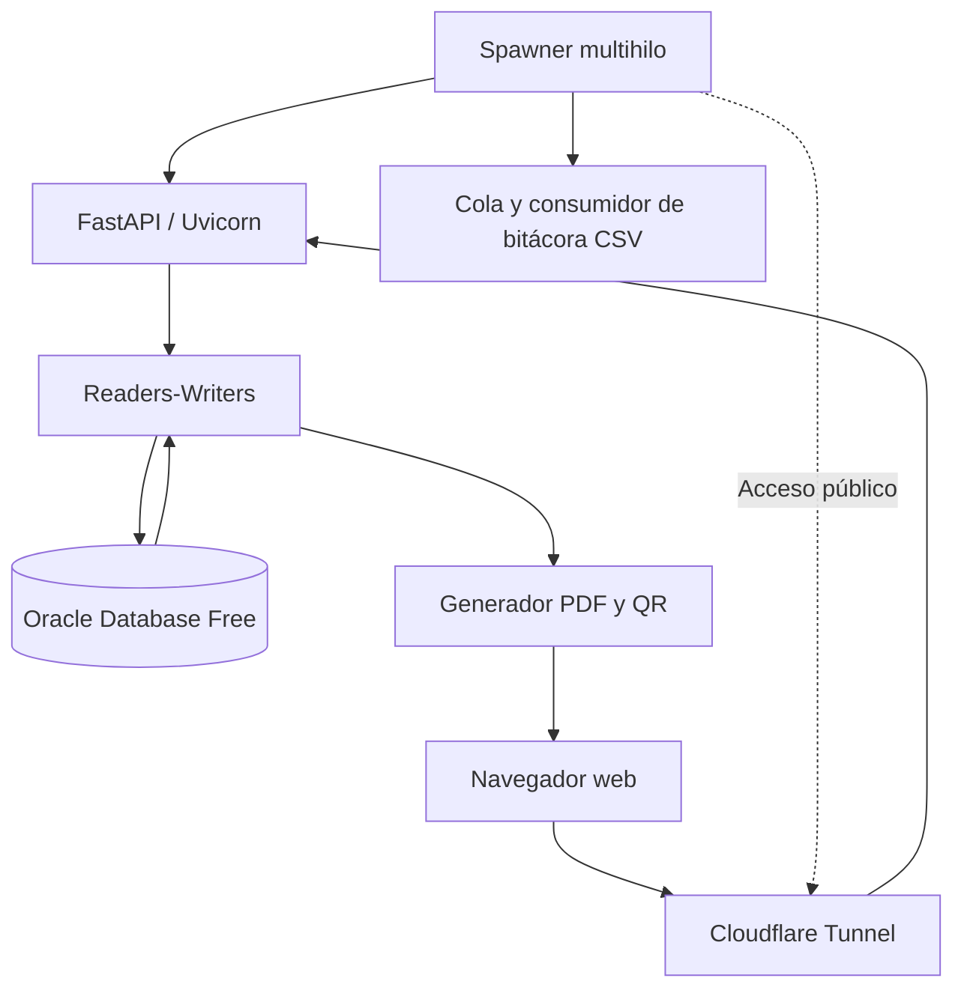

# Auditorio Plata

Sistema de emisión de boletos gratuitos para el
Concierto Navideño.

**Aforo máximo:** 20,000 personas.

Proyecto académico de Sistemas Operativos. Su objetivo es emitir 100 boletos en 60 segundos o menos mediante solicitudes concurrentes, manteniendo la integridad de los folios y del aforo.

## Funcionalidades

- Consulta periódica de boletos emitidos y lugares disponibles.
- Emisión gratuita de boletos GENERAL, PREFERENTE y VIP, con diseños PDF diferentes.
- Código QR con los datos del evento, tipo de boleto, folio, fecha y hora de emisión.
- Almacenamiento en Oracle y prevención de solicitudes duplicadas mediante `solicitud_id`.
- Spawner multihilo configurable, bitácoras CSV y laboratorio de condiciones de carrera.

## Repositorio y publicación

- Repositorio: https://github.com/alang5/Auditorio_Plata
- URL pública utilizada en la prueba del 26/11/2026: https://notified-balanced-say-farms.trycloudflare.com

La URL pública pertenece a un túnel temporal y puede dejar de funcionar cuando se detiene o reinicia Cloudflare. Para una nueva ejecución, utilizar la URL que aparezca en la terminal del túnel (véase la sección 9).

## Tecnologías
- Python
- FastAPI
- Oracle Database
- Readers-Writers
- Threading
- HTML, CSS y JavaScript
- ReportLab y qrcode
- Requests
- Cloudflare Tunnel


## Arquitectura y sincronización



El servidor utiliza Readers-Writers para permitir consultas simultáneas y garantizar que solo un escritor pueda emitir boletos a la vez. La sección crítica protege la asignación del folio y la actualización del aforo. Oracle refuerza esta protección mediante `SELECT ... FOR UPDATE`, la secuencia `seq_folio`, restricciones de integridad y transacciones.

En el cliente, un semáforo limita las solicitudes simultáneas, una barrera coordina el arranque en modo ráfaga y una cola implementa productor–consumidor para guardar la bitácora mediante un hilo dedicado. En modo uniforme, el pool programa las solicitudes durante la ventana reservando 10 segundos de margen.

La implementación de Readers-Writers da preferencia a los lectores; bajo una carga continua de lecturas puede existir espera prolongada de escritores.

## Estructura del proyecto

```text
Auditorio_Plata/
├── servidor/
│   ├── main.py
│   ├── database.py
│   ├── readers_writers.py
│   ├── boletos_pdf.py
│   └── static/
├── spawner/
│   ├── spawner.py
│   └── resultados/             # CSV generados localmente
├── pruebas/
│   ├── condicion_carrera.py
│   ├── prueba_concurrencia.py
│   ├── demo_web.py
│   ├── demo_web.html
│   └── resultados_demo_web/
├── sql/
│   └── esquema.sql
├── requirements.txt
└── README.md
```

## Instalación y ejecución de Auditorio Plata

### 1. Requisitos previos

Para ejecutar el proyecto se necesita:

- Python 3.11 o superior.
- Git.
- Oracle Database Free (local o remoto).
- Acceso a una terminal (PowerShell, CMD o Bash).
- Conexión a internet para instalar las dependencias.
- Cloudflare Tunnel (opcional, para acceso público).

> La base de datos Oracle debe estar configurada y accesible antes de iniciar el servidor.

### 2. Descargar el repositorio

Clonar el proyecto desde GitHub:

```bash
git clone https://github.com/alang5/Auditorio_Plata
cd Auditorio_Plata
```

### 3. Crear y activar el entorno virtual

**Windows (PowerShell):**

```powershell
python -m venv .venv
.\.venv\Scripts\Activate.ps1
```

**Linux/macOS:**

```bash
python3 -m venv .venv
source .venv/bin/activate
```

Instalar las dependencias:

```bash
python -m pip install -r requirements.txt
```

El archivo incluye las librerías necesarias para FastAPI, Oracle, PDF, QR y el spawner.

### 4. Configurar Oracle Database

La aplicación utiliza Oracle Database Free mediante el puerto 1521 y el servicio `FREEPDB1` en la instalación local de Windows utilizada durante el desarrollo.

Es necesario crear un usuario con permisos para administrar las tablas y secuencias.

Conectarse como administrador mediante SQL*Plus:

```bash
sqlplus system@localhost:1521/FREEPDB1
```

Ejecutar los siguientes comandos SQL únicamente si el usuario todavía no existe:

```sql
CREATE USER auditorio_app
IDENTIFIED BY "CONTRASENA_SEGURA"
DEFAULT TABLESPACE USERS
QUOTA 100M ON USERS;

GRANT CREATE SESSION, CREATE TABLE, CREATE SEQUENCE
TO auditorio_app;
```

Crear las tablas, restricciones y secuencias utilizando el script del repositorio:

```bash
sqlplus auditorio_app@localhost:1521/FREEPDB1 @sql/esquema.sql
```

SQL*Plus solicitará la contraseña del usuario.

> Este script se ejecuta solamente para inicializar una base de datos nueva. No debe ejecutarse nuevamente sobre tablas que ya contienen boletos.

**Actualización de una instalación anterior:** si ya existe la tabla `boletos`, consultar `DESC boletos;`. Solo si todavía no existe la columna `TIPO_BOLETO`, ejecutar:

```sql
ALTER TABLE boletos
ADD tipo_boleto VARCHAR2(20) DEFAULT 'GENERAL' NOT NULL;
```

Los boletos anteriores conservarán sus folios y quedarán con tipo GENERAL. El esquema actualizado ya incluye esa columna para las instalaciones nuevas.

### 5. Configurar las variables de entorno

En la raíz del proyecto, crear un archivo llamado `.env`:

```dotenv
ORACLE_USER=auditorio_app
ORACLE_PASSWORD=CONTRASENA_SEGURA
ORACLE_DSN=localhost:1521/FREEPDB1
```

Modificar los valores según la configuración de Oracle.

Si la base de datos está alojada en otro servidor, sustituir `localhost` por su dirección y utilizar el puerto y nombre de servicio correspondientes.

> Por seguridad, `.env` no debe subirse a GitHub. Está excluido mediante `.gitignore`.

### 6. Iniciar el servidor web

Desde la raíz del proyecto, con el entorno virtual activado:

```bash
python -m uvicorn servidor.main:app --host 127.0.0.1 --port 8000
```

Abrir las siguientes direcciones:

| Dirección | Descripción |
|---|---|
| http://127.0.0.1:8000/ | Página principal |
| http://127.0.0.1:8000/aforo | Consulta de disponibilidad |
| http://127.0.0.1:8000/docs | Documentación de la API |

La página permite consultar el aforo, seleccionar GENERAL, PREFERENTE o VIP y descargar el PDF con su código QR. El tipo se guarda en Oracle para conservar el diseño correcto en futuras descargas.

| Método | Endpoint | Función |
|---|---|---|
| GET | `/aforo` | Consultar disponibilidad |
| POST | `/boletos` | Emitir boleto (GENERAL por defecto) |
| GET | `/boletos/{folio}/pdf` | Descargar el boleto por folio |

Para detener el servidor, presionar `Ctrl + C`.

### 7. Ejecutar el spawner concurrente

Mantener FastAPI ejecutándose y abrir una segunda terminal.

Activar el entorno virtual y ejecutar:

```bash
python -m spawner.spawner --solicitudes 100 --hilos 100 --concurrentes 10 --modo uniforme --ventana 60
```

Para ejecutar una prueba en modo ráfaga:

```bash
python -m spawner.spawner --solicitudes 100 --hilos 100 --concurrentes 10 --modo rafaga --ventana 60
```

En modo ráfaga se recomienda configurar el mismo número de hilos y solicitudes, como en el ejemplo, para que la barrera reúna a todos los solicitantes iniciales.

El spawner genera boletos GENERAL por defecto. El parámetro `--timeout` permite configurar el tiempo de espera de cada solicitud (15 segundos por defecto).

El spawner utiliza hilos para realizar solicitudes HTTP al servidor y registra:

- Identificador del hilo.
- Hora de envío y recepción.
- Folio obtenido.
- Estado de la solicitud.
- Latencia de respuesta.

Los resultados se guardan automáticamente en:

```text
spawner/resultados/
```

**Nota:** estas pruebas generan boletos reales en Oracle y modifican el contador de aforo.

### 8. Laboratorio de condiciones de carrera

El proyecto incluye un laboratorio web independiente para demostrar el comportamiento del sistema sin y con sincronización.

Iniciar el laboratorio:

```bash
python -m uvicorn pruebas.demo_web:app --host 127.0.0.1 --port 8001
```

Abrir:

http://127.0.0.1:8001/

La página permite ejecutar dos experimentos:

- Sin sincronización: demuestra folios duplicados y actualizaciones perdidas.
- Con Readers–Writers: controla el acceso a la sección crítica y respeta el aforo experimental.

Ambas pruebas utilizan 10 solicitudes HTTP y un aforo de 3 lugares.

Los resultados se guardan en:

```text
pruebas/resultados_demo_web/
```

Este laboratorio utiliza un contador experimental en memoria y no modifica la base de datos Oracle.

También se pueden ejecutar las pruebas de consola desde la raíz del proyecto:

```bash
python -m pruebas.condicion_carrera
python -m pruebas.prueba_concurrencia
```

### 9. Acceso público mediante Cloudflare Tunnel (opcional)

Para acceder a la aplicación desde otra computadora o celular a través de internet, instalar `cloudflared`.

En Windows:

```powershell
winget install --id Cloudflare.cloudflared -e
```

Con FastAPI ejecutándose en el puerto 8000, abrir otra terminal y ejecutar:

```powershell
cloudflared tunnel --url http://127.0.0.1:8000
```

Cloudflare generará una URL HTTPS temporal con un formato similar a:

```text
https://nombre-aleatorio.trycloudflare.com
```

Para probar el spawner mediante internet, sustituir la URL del ejemplo por la URL activa del túnel:

```powershell
python -m spawner.spawner --url "https://nombre-aleatorio.trycloudflare.com" --solicitudes 100 --hilos 100 --concurrentes 10 --modo uniforme --ventana 60
```

No incluir espacios al final de la URL ni agregar `/boletos`, ya que el cliente añade esa ruta automáticamente.

**Consideraciones:**

- El túnel es temporal.
- La URL puede cambiar cada vez que se reinicia.
- FastAPI y Cloudflare deben permanecer ejecutándose.
- La computadora anfitriona debe mantenerse encendida.
- No equivale a un servidor alojado permanentemente en la nube.
- No se recomienda exponer públicamente los endpoints sin protección de acceso.

### 10. Ejecución en otra computadora

Para instalar el proyecto en otro equipo se deben realizar los pasos 1 al 6, asegurándose de configurar correctamente la conexión a Oracle.

No es necesario instalar Oracle en cada computadora si todas se conectan a una base de datos remota existente.

Si solamente se desea utilizar la página como usuario, basta con abrir su URL pública desde un navegador; no se requiere instalar Python ni Oracle.

### 11. Detener los servicios

Para finalizar la ejecución:

1. Detener FastAPI con `Ctrl + C`.
2. Detener el spawner o laboratorio, si están ejecutándose.
3. Detener Cloudflare Tunnel con `Ctrl + C`.

Los datos almacenados en Oracle permanecen guardados después de detener la aplicación.


## Resultados experimentales

### Rendimiento de la versión final (26/11/2026)

Configuración: 100 solicitudes, 100 hilos configurados, máximo de 10 solicitudes simultáneas, modo uniforme y ventana de 60 segundos.

| Métrica | Localhost | Cloudflare |
|---|---:|---:|
| Boletos emitidos | 100 | 100 |
| Rechazos | 0 | 0 |
| Errores | 0 | 0 |
| Folios duplicados | 0 | 0 |
| Tiempo total | 49.58 s | 50.09 s |
| Respuesta promedio | 69.98 ms | 597.46 ms |
| Rendimiento | 2.02 boletos/s | 2.00 boletos/s |
| Meta cumplida | Sí | Sí |

Las dos pruebas cumplieron la meta. El acceso público aumentó la latencia promedio, pero la ejecución concurrente permitió mantener el tiempo total por debajo de 60 segundos.

Bitácoras correspondientes: `bitacora_20261126_013744.csv` (local) y `bitacora_20261126_013938.csv` (Cloudflare), generadas en `spawner/resultados/`.

### Condiciones de carrera

Resultados del laboratorio experimental de 10 solicitudes con aforo de 3 lugares:

| Métrica | Sin sincronización | Con Readers-Writers |
|---|---:|---:|
| Solicitudes aceptadas | 10 | 3 |
| Solicitudes rechazadas | 0 | 7 |
| Folios duplicados (repeticiones) | 9 | 0 |
| Sobrecupo | 7 | 0 |

El laboratorio muestra las consecuencias de acceder a un recurso compartido sin exclusión mutua. Con Readers-Writers se conserva el aforo y no se repiten folios.

### Integridad de Oracle

En la consulta del 26/11/2026 se registraron 418 boletos emitidos, 418 folios únicos, cero duplicados y 19,582 lugares disponibles. La lectura de los QR de las tres categorías fue comprobada por el equipo.

Consultas de verificación (solo lectura):

```sql
SELECT nombre, aforo, emitidos, aforo - emitidos AS disponibles
FROM eventos;

SELECT COUNT(*) AS total_boletos,
       COUNT(DISTINCT folio) AS folios_unicos,
       COUNT(*) - COUNT(DISTINCT folio) AS duplicados
FROM boletos;

SELECT tipo_boleto, COUNT(*) AS cantidad
FROM boletos
GROUP BY tipo_boleto;
```

## Documentación y evidencias

El reporte académico complementa este README con la justificación de los algoritmos, la comparación teórica con Peterson y la Panadería de Lamport, diagramas, resultados y muestras de boletos.

Las bitácoras del spawner se generan localmente y su carpeta está excluida en `.gitignore`. Para entregar evidencias en GitHub, se pueden copiar únicamente los CSV seleccionados y el reporte a una carpeta `docs/`, revisando antes que no contengan información sensible.
